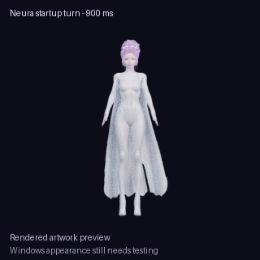

# Neura startup turntable

PR #271 rotated a front portrait through a perspective matrix. At 180 degrees
that displayed her mirrored face, and the source artwork had outstretched
arms. The replacement uses 32 genuine views of the owner's existing rigged
Lumen avatar, with the original animation disabled and both arms lowered.
It retains the original white/violet Lumen artwork identity used at startup.
It does not change the selected companion avatar or claim to turn the separate
procedural Nebula or photographic Realistic Nebula portrait into a 3D rig.



This is a rendered artwork preview, not a recording of a Windows app launch.
All views share one model, pose, camera framing and texture. The original
mesh's cape and hands retain its existing skinning limits; no new cloth or
finger simulation is claimed.

## Runtime behavior

- One 900 ms eased turn starts after its local atlas is ready. Readiness and
  navigation never wait for artwork or animation. Fast startup can skip or
  truncate the turn.
- The existing breathing ticker also selects the turn's frame. A frame crop
  changes its silhouette and reveals its real back; no perspective flip,
  horizontal mirroring or additional ticker is used.
- Safe Mode, recovery, Still, reduced motion, hidden routes and backgrounding
  stop motion. An interrupted or completed turn returns to frame zero and
  cannot replay when that widget resumes. A fresh launch owns a fresh turn.
- The early bootstrap frame is static while preferences have not loaded.
- Static and failure states use the same arms-down front view. A missing or
  invalid turn atlas falls back to that front. If both images are unavailable,
  a static face icon remains available. No old T-pose fallback is introduced.
- No runtime model, 3D engine, network, microphone or speech request is added.

## Resource bounds and provenance

The shipped atlas is 1280 x 960 pixels: 32 cells, each 160 x 240, in eight
columns and four rows. One decoded RGBA image takes 4,915,200 bytes (4.69 MiB),
excluding Flutter/GPU/cache overhead. The front uses at most another 153,600
decoded bytes. High pixel density cannot enlarge these sources. This is an
image budget, not a measured whole-app memory or performance claim.

`assets/images/neura_startup_turntable.json` records source SHA-256 hashes,
Blender version, render angles, alpha bounds, atlas size and generated hashes.
The source FBX and texture came from the owner's existing Lumen avatar package.
Neither that original package nor its full rig or textures ships in the app.
Blender and Pillow are artwork-build tools only; Flutter dependencies and
lockfiles are unchanged.

To reproduce locally, use Blender 4.3.2 and the matching source files:

```sh
blender -b -t 2 --python tools/render_neura_startup_turntable.py -- \
  --model '/path/to/Meshy_AI_Lumen_Heart_biped_Character_output.fbx' \
  --texture '/path/to/Meshy_AI_Lumen_Heart_biped_texture_0.png' \
  --output '/temporary/turntable_frames'
python3 tools/pack_neura_startup_turntable.py '/temporary/turntable_frames' \
  --preview docs/previews/neura_startup_turntable.gif
```

## Validation and Windows acceptance

The focused Flutter suites cover the real atlas's side/rear pixels, fixed
decode dimensions, one-time timing, continued breathing, lifecycle and route
interruption, reduced motion, Safe Mode integration and missing artwork.
These do not prove visual appearance, physical frame pacing or laptop RAM.

Use a separate disposable Windows test account; a new extraction folder alone
can still share application data. Do not open the existing owner workspace or
copy encrypted memories. No AI model, cloud configuration or microphone is
needed for the visual trial.

1. Record a cold launch, then replay slowly. Confirm both arms stay down, the
   quarter views retain body thickness, the halfway view shows the back, and
   the finish faces forward. Inspect hands, cape, feet, clipping and flicker.
2. Switch away during the turn and return. Expect the forward pose and no
   replay. Repeat with Safe Mode, Still and reduced motion in the test account.
3. Compare at least five cold and five warm launches on the same laptop and
   configuration. Record time to first frame and usable dashboard, peak RAM,
   CPU and visible stutter. Navigation must not acquire a 900 ms minimum delay.
4. Record the exact preview head/package identity and observed results. The
   target laptop has approximately 8 GB RAM; its acceptance remains pending
   until those observations exist. Keep the change unmerged for owner review.
